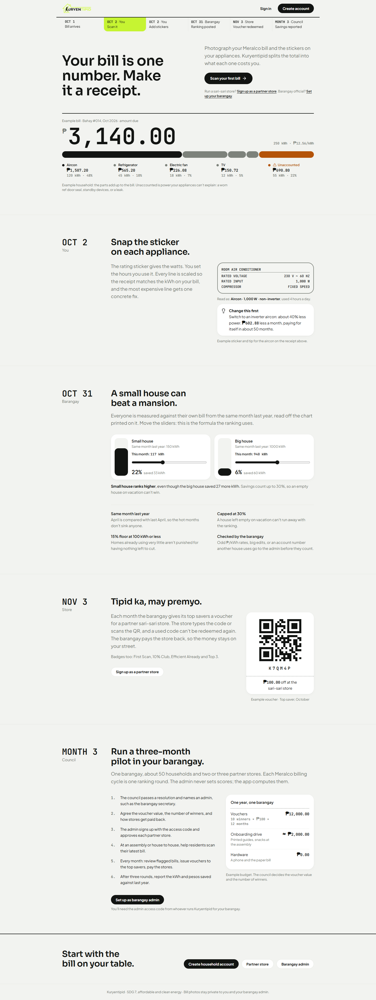
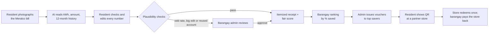
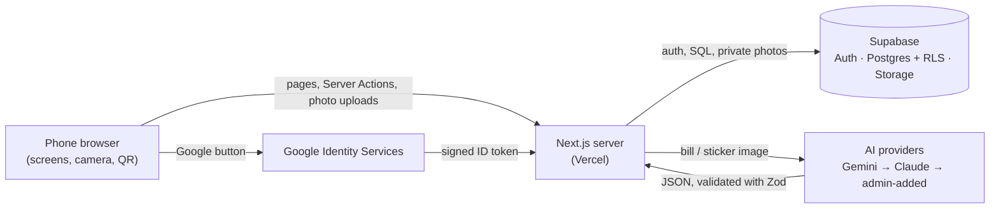
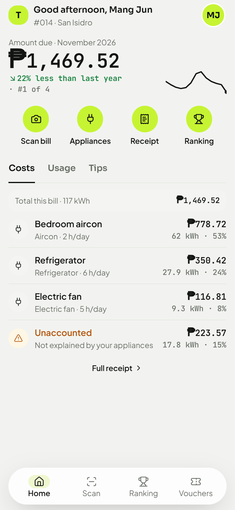
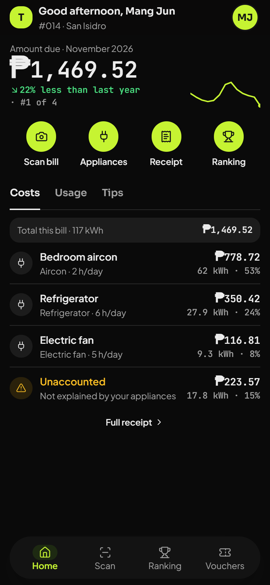
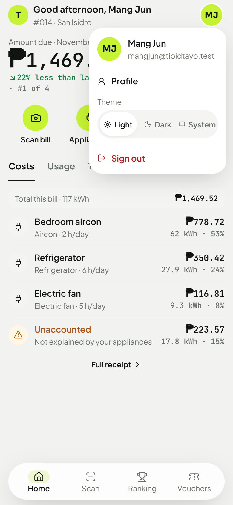
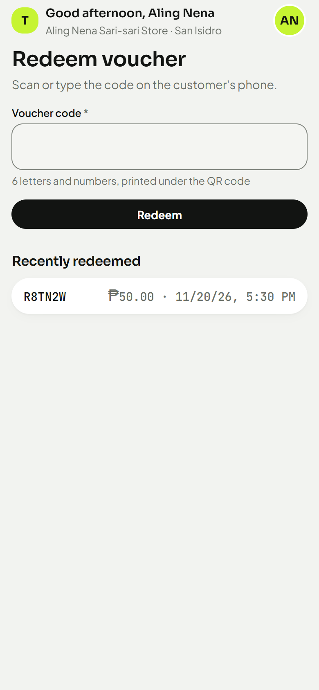
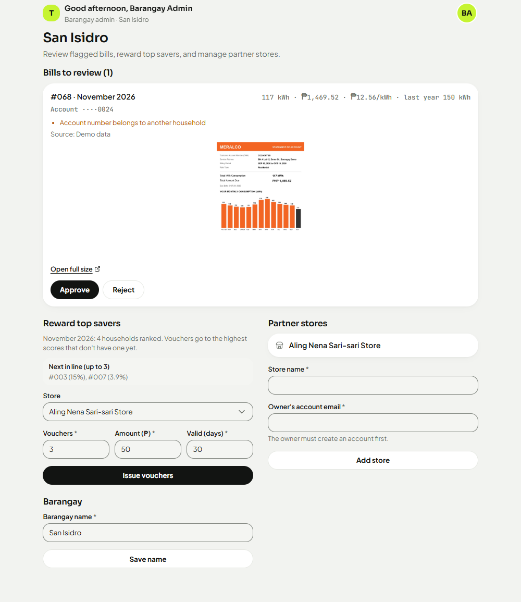
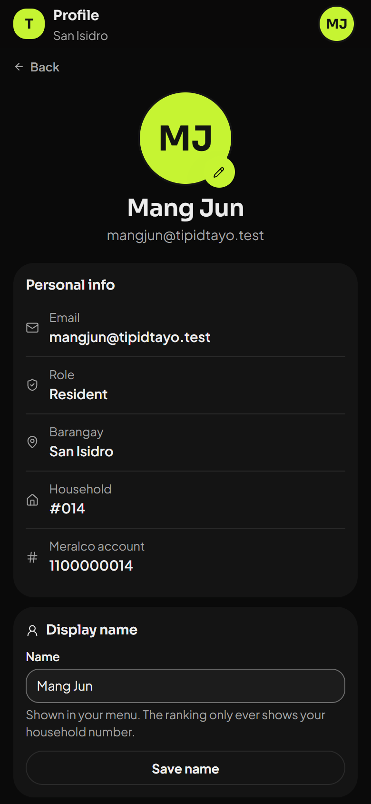

# Kuryentipid

> Your barangay's fair energy-saving challenge. Photograph your Meralco bill and your appliance stickers to see what each appliance really costs you, then compete with your neighbors on **% saved against your own last year**, not raw kWh, for badges and sari-sari store vouchers.

**SDG 7: Affordable and Clean Energy** (targets 7.1 and 7.3), with SDG 11 (sustainable communities). No smart meter, no hardware, no app store: a phone browser and the paper bill.



**Status:** MVP complete. Unit and end-to-end tests pass. Remaining: deploy, test with real Meralco bills, rehearse the demo ([TASKS.md](TASKS.md)).

## Contents

1. [The problem](#1-the-problem)
2. [How it works](#2-how-it-works)
3. [What makes it different](#3-what-makes-it-different)
4. [Features](#4-features)
5. [Tech stack](#5-tech-stack)
6. [Architecture](#6-architecture)
7. [AI photo reading](#7-ai-photo-reading)
8. [Security and privacy](#8-security-and-privacy)
9. [Getting started](#9-getting-started)
10. [Testing](#10-testing)
11. [Screenshots](#11-screenshots)
12. [Judging criteria](#12-judging-criteria)
13. [Scope and roadmap](#13-scope-and-roadmap)
14. [Project docs and process](#14-project-docs-and-process)

---

## 1. The problem

An electric bill is **one number**. Households can't cut what they can't see, so they switch off lights (which barely matter) while an old refrigerator or a non-inverter aircon eats most of the bill. People who do save get no feedback, recognition or reward, so they stop. And community saving drives that rank by raw kWh are unfair: a big house can "save" more kWh by accident than a small house uses in a month.

| Who | What they need |
|---|---|
| **Residents** who pay their own Meralco bill (main user) | See which appliance to fix, in pesos, and a fair reason to keep saving |
| **Barangay officials** | Run the challenge, review suspicious bills, reward top savers, report results to the council |
| **Sari-sari store owners** | Accept vouchers safely and get paid back by the barangay |

## 2. How it works

One Meralco billing cycle is one round. Each role does its part on its own day:



| Day | Who | What happens in the app |
|---|---|---|
| **Bill arrives** | Resident | Takes a photo of the bill (or types it in). AI reads account number, billing period, kWh, amount due and the 12-month usage chart; every field stays editable. |
| **Same day** | Resident | Photographs appliance rating stickers (or picks from a list with typical watts) and sets hours per day. Gets an **itemized receipt**: each appliance in kWh and pesos, adding up to the real bill, plus one concrete fix for the top costs. |
| **Month end** | Barangay admin | Reviews the few bills the app flagged; the ranking is computed automatically. Issues vouchers to the top savers at an approved partner store. |
| **Next days** | Store owner | Scans the resident's QR or types the 6-character code. Each code works **once**. The store page shows the total the barangay owes it. |
| **After 3 rounds** | Barangay council | Compares total kWh and pesos saved against the same months last year. |

## 3. What makes it different

### Fair scoring: you compete against your own last year

| Rule | Why |
|---|---|
| **Baseline = same month last year**, read from the 12-month chart printed on the bill (average of the last 3 months if missing) | Removes the summer penalty; nobody can inflate a past month to game it |
| **Savings % = (baseline − this month) ÷ baseline**, capped at **30%** | An empty house on vacation can't win |
| **Homes at ≤ 100 kWh score at least 15%** ("Efficient Already" badge) | Households already using very little aren't punished for having nothing left to cut |
| **One Meralco account number = one household** | The same bill can't score twice |
| **Plausibility:** rate must be ₱8–₱20/kWh; edits over 10% from the scan, savings over 50%, or another household's account number go to the barangay for review | Catches a neighbor's bill, an edited photo or an inflated baseline |

*Example:* a small house going from 150 to 117 kWh scores **22%**; a big house going from 1,000 to 940 kWh scores **6%**. The small house ranks higher even though the big one cut more kWh.

### The receipt has to add up

Most apps multiply watts by guessed hours and their totals never match the bill. Kuryentipid scales every appliance estimate so the lines **sum to the kWh on the real bill**. Usage the appliances can't explain appears as an **Unaccounted** line: a forgotten appliance, a worn refrigerator door seal, standby power or a wiring leak. Pesos use the bill's effective rate (amount ÷ kWh), because a Meralco bill includes generation, transmission and other charges.

### Local by design

One barangay, its own partner sari-sari stores, its own budget. Vouchers keep the reward money in the local economy, and neighbors see only a household number (e.g. *Bahay #014*), % saved and badges.

## 4. Features

| Area | What works |
|---|---|
| **Sign-up by role** | Household, Sari-sari store (waits for the admin's approval before it can receive vouchers) or Barangay admin (needs the admin access code). Email + password or Google. Privacy consent (Data Privacy Act, RA 10173) is required. A failed sign-in says whether the email isn't registered, uses Google, or has the wrong password. |
| **Scan the bill** | AI extraction of every bill field and the usage chart; manual entry always available; live "₱ per kWh" check. |
| **Scan appliances** | Rating-sticker photo → type and watts; inverter detection; hours per day. |
| **Itemized receipt** | Per-appliance kWh and ₱, reconciled to the bill, sorted by cost, Unaccounted line, top-3 swap tips with monthly saving and payback months. |
| **Ranking** | Monthly barangay ranking by fair score, showing both score and actual % saved; your row stays pinned while you scroll. |
| **Badges** | First Scan, 10% Club, Efficient Already, Top 3. |
| **Vouchers** | Single-use QR + 6-character code per top saver; store redeems by camera (where the browser supports it) or by typing. |
| **Store page** | Redeem, see every redeemed voucher and the total owed by the barangay; "waiting for approval" state for new stores. |
| **Admin page** | Flagged-bill review with photo and source, store sign-up approvals, voucher issuing with "next in line" preview, partner stores with redeemed totals, barangay name, and the **AI provider chain** (below). |
| **Profile** | Display name, avatar, light / dark / system theme. |
| **Every screen** | Loading skeletons, empty states, error boundaries with retry, toasts, confirm dialogs, mobile-first at 375px, keyboard and screen-reader support. |

## 5. Tech stack

| Layer | Technology | Why |
|---|---|---|
| App framework | **Next.js 16.4** (App Router, Server Components, Server Actions), **React 19.3**, **TypeScript** (strict) | Screens and server code in one project and one deploy; secrets never leave the server |
| Database | **Supabase Postgres** | Real SQL constraints (unique account number, single-use voucher via one atomic `UPDATE`), Row Level Security as defense in depth |
| Auth | **Supabase Auth** (email + password, accounts created server-side as confirmed) + **Google Identity Services** (ID token verified on the server) | No email round-trip during a live demo; Google needs only a public client ID |
| File storage | **Supabase Storage** | Private bucket for bill photos (owner + barangay admin only); public bucket for avatars |
| AI vision | **Google Gemini** (`@google/genai`, free tier) → optional **Claude** (`@anthropic-ai/sdk`) → providers the admin adds (OpenAI, Grok, Groq, OpenRouter or any OpenAI-compatible API) → manual entry | A quota or outage never blocks scanning |
| Validation | **Zod 4** | One schema validates AI output, browser forms and server input |
| Styling | **Tailwind CSS 4.3** with design tokens in `src/app/globals.css` (light + dark) | Tokens enforce [DESIGN_SYSTEM.md](DESIGN_SYSTEM.md) |
| UI | Own primitives (`components/ui.tsx`, `field.tsx`, `form.tsx`), **lucide-react** icons, **sonner** toasts | Small, accessible, no component-library weight |
| QR | **qrcode** (generate) + the browser's native `BarcodeDetector` (scan) | No scanner dependency; the typed code always works |
| Fonts | Sora (headings), Plus Jakarta Sans (body), JetBrains Mono (numbers) via `next/font` | Tugon design system |
| Testing | Node's built-in test runner (scoring rules), **Playwright** driving Microsoft Edge (end-to-end) | No test framework to install for unit tests |
| Database migrations | Plain SQL in `supabase/migrations`, applied by `scripts/db-migrate.mjs` (`pg`) | The Supabase CLI wouldn't install on Windows |
| Hosting | **Vercel** + Supabase cloud (free tiers for a pilot) | Zero-config Next.js hosting |

No dependency is added without a written reason (see [ARCHITECTURE.md](ARCHITECTURE.md) decision log).

## 6. Architecture



- **Browser:** takes photos, renders screens, validates forms instantly with the same Zod rules the server uses.
- **Server:** holds every secret, calls the AI chain, validates all input, computes reconciliation and the fair score (pure, unit-tested functions in `src/lib/scoring`), checks roles on every page and action.
- **Database:** constraints and RLS are the last line of defense. Roles: `resident`, `store`, `admin`.

```
src/
├── app/
│   ├── page.tsx                 homepage (one billing month)
│   ├── login/                   sign-in / sign-up with roles, Google button
│   ├── (resident)/              home, scan, receipt, ranking, vouchers
│   ├── store/                   voucher redemption
│   ├── admin/                   review, stores, vouchers, AI providers
│   ├── profile/
│   └── api/extract/{bill,appliance}/   photo → AI chain
├── components/                  ui primitives, forms, landing
└── lib/
    ├── scoring/                 reconcile, fair score, plausibility (+ tests)
    ├── extraction/              AI chain, presets, Zod schemas, rate limit
    ├── supabase/                server clients
    └── secret-box.ts            AES-256-GCM for stored AI keys
supabase/migrations/             schema, RLS, functions
scripts/                         db-migrate, seed-demo, e2e, fixtures
```

Full details: schema, API conventions and every decision with its reason in [ARCHITECTURE.md](ARCHITECTURE.md).

## 7. AI photo reading

Each photo goes through a **fallback chain**; the first answer that passes Zod validation wins, and if every step fails the resident types the numbers in, so scanning never dead-ends.

1. Gemini models from `GEMINI_MODELS` (free tier, e.g. Flash-Lite first, Flash as the accuracy backstop)
2. Claude, if `ANTHROPIC_API_KEY` is set
3. **Providers the barangay admin added** on the admin page: OpenAI (ChatGPT / Codex accounts), Anthropic, Google Gemini, xAI Grok, Groq, OpenRouter, or any OpenAI-compatible `https://` API
4. Manual entry (always)

**Adding a provider is test-first.** The admin picks a provider, model and API key and presses **Run test**: the app sends a sample bill photo to that provider alone and shows a step-by-step log (request, timing, what it read, PASS/FAIL). **Add to the chain** unlocks only after a pass, and the server checks a signed proof of that exact test before saving. Keys are stored encrypted and only their last 4 characters are ever shown. Photo reading is capped at 20 attempts per user per hour to protect free quotas.

## 8. Security and privacy

- **Secrets stay on the server.** The browser only ever sees the Supabase URL, the publishable key and the Google client ID.
- **Roles are checked on the server** in every page layout and action; RLS lets a signed-in user read only their own rows.
- **No self-made admins or fake stores.** Admin sign-up needs `ADMIN_SIGNUP_CODE` (constant-time compare); a self-registered store can't receive vouchers until the admin approves it.
- **Google sign-in** is verified server-side (issuer, audience = our client ID, verified email) before any session starts; a new Google account must go through sign-up to choose a role and give consent.
- **AI provider keys** are encrypted with AES-256-GCM; error messages are scrubbed of the key.
- **Bill photos** live in a private bucket, shown to the barangay admin through short-lived signed URLs.
- **Vouchers** are redeemed by one atomic database update, so a code can't be used twice, even with double taps.
- **Privacy (RA 10173):** consent is required and timestamped at sign-up; neighbors see only a household number, % saved and badges, never a name, address or bill.
- Security headers (`nosniff`, frame denial, referrer policy, camera-only permissions, HSTS) in `next.config.ts`.

## 9. Getting started

### Prerequisites

- Node.js 22
- A Supabase project (free tier)
- A Google AI Studio API key for Gemini (free tier)
- A Google Cloud OAuth client (Web application) for Google sign-in

### Setup

```bash
git clone https://github.com/sandoval02/kabuteam.git && cd kabuteam
cp .env.example .env.local      # fill in the values below
npm install
npm run db:migrate              # applies supabase/migrations (needs SUPABASE_DB_URL)
npm run seed:demo               # optional: demo barangay (needs DEMO_PASSWORD)
npm run dev                     # http://localhost:3000
```

If `npm run db:migrate` fails with `ECONNRESET`, your network blocks Postgres port 5432: use the same `SUPABASE_DB_URL` with port **6543** (Supabase transaction pooler).

### Environment variables (`.env.local`)

| Variable | Where it comes from | Exposed to browser? |
|---|---|---|
| `NEXT_PUBLIC_SUPABASE_URL`, `NEXT_PUBLIC_SUPABASE_PUBLISHABLE_KEY` | Supabase → Connect → Next.js | Yes (public by design) |
| `SUPABASE_SECRET_KEY` | Supabase → Project Settings → API Keys (`sb_secret_…`) | **No** |
| `SUPABASE_DB_URL` | Supabase → Connect → Session pooler URI (migrations only) | **No** |
| `GEMINI_API_KEY`, `GEMINI_MODELS` | aistudio.google.com/apikey; comma-separated model IDs tried in order | **No** |
| `ANTHROPIC_API_KEY`, `ANTHROPIC_MODEL` | Optional Claude step | **No** |
| `NEXT_PUBLIC_GOOGLE_CLIENT_ID` | Google Cloud → Credentials → OAuth client ID (the client secret is **not** used) | Yes (public by design) |
| `ADMIN_SIGNUP_CODE` | Any random string of 12+ characters; share only with barangay officials | **No** |
| `ADMIN_EMAILS` | Optional: emails that always become admins | **No** |
| `DEMO_PASSWORD` | Password for the seeded demo accounts | **No** |

Add the same variables in **Vercel → Project → Settings → Environment Variables** when deploying.

### Google sign-in (Google Cloud Console)

1. **APIs & Services → Credentials →** your OAuth client → **Authorized JavaScript origins:** add `http://localhost`, `http://localhost:3000` and your deployed URL (e.g. `https://your-app.vercel.app`). No redirect URI is needed.
2. **OAuth consent screen:** app name and support email. While it is in *Testing*, only listed **test users** can sign in; publish it to open sign-in to everyone (name and email scopes need no Google review).
3. Changes can take a few minutes to a few hours to apply. Nothing needs to be enabled in Supabase. Never commit the downloaded `client_secret_*.json` (it is git-ignored).

### Roles and demo accounts

- **Household:** sign up normally.
- **Sari-sari store:** sign up as a store with its name; the barangay admin approves it on the admin page.
- **Barangay admin:** sign up as admin with `ADMIN_SIGNUP_CODE` (or use an email listed in `ADMIN_EMAILS`).
- **Demo** (after `npm run seed:demo`): `resident@`, `neighbor@`, `admin@`, `store@tipidtayo.test` plus 5 more households, all with `DEMO_PASSWORD`. The 2-minute demo script is in [DEMO.md](DEMO.md).

## 10. Testing

```bash
npm test        # scoring rules: baseline, fair score, cap, low-usage floor, reconciliation, badges, plausibility, swap tips
npm run e2e     # with `npm run dev` running: the whole loop in Microsoft Edge with throwaway accounts
npm run lint
npm run build
```

The end-to-end run covers the homepage, sign-up with consent, bill entry, appliances, receipt, real Gemini bill and sticker scans, the hourly scan cap, flagging, ranking order, a forged Google token being refused, store sign-up and approval, admin access code, an AI provider test, admin review, vouchers, single-use redemption, profile and theme, sign out and role checks. It fails on any browser console error and deletes its accounts afterwards. Manual checks are in [TESTING.md](TESTING.md).

## 11. Screenshots

| Home (light) | Home (dark) | Avatar menu |
|---|---|---|
|  |  |  |

| Receipt | Ranking | Vouchers |
|---|---|---|
|  |  |  |

| Store redeem | Admin review | Profile |
|---|---|---|
|  |  |  |

Screens show an example barangay with seeded demo data.

## 12. Judging criteria

Each criterion is worth 20%.

| Criterion | Our case | Proof in the demo |
|---|---|---|
| **Technical quality** | Vision extraction from two document types through a validated multi-provider fallback chain; reconciliation to the bill total; fair-score rules with anti-cheat checks; RLS, server-side role checks, encrypted keys, atomic single-use vouchers | Redeem the same voucher twice: the second try says "already used" |
| **Functionality** | The full loop works for all three roles with loading, error and empty states; no mocked screens | Scan → receipt → ranking → voucher → store redemption, live, in under 2 minutes |
| **Innovation** | A receipt calibrated to the real bill, with an honest Unaccounted line | Open the receipt: the lines add up to the bill |
| **Originality** | Ranking by % saved against your own same month last year, rewarded at the barangay's own sari-sari stores | The small house at 22% ranks above the big house at 6% |
| **Presentation** | A real bill, a real store owner's view, and a fallback for every step that can fail | If the AI is slow, type the numbers in: "the AI suggests, the resident confirms" |

## 13. Scope and roadmap

**Out of scope for the MVP:** meter camera / real-time monitoring, payments or money transfer (the barangay pays stores back outside the app), multiple barangays, bills other than Meralco, SMS/push notifications, a native app.

**Next:** a meter camera (an old phone counting the meter's pulse LED for daily feedback and a "Meter-Verified" badge), store pay-back tracking, and winner notifications.

## 14. Project docs and process

| File | Purpose |
|---|---|
| [ARCHITECTURE.md](ARCHITECTURE.md) | Architecture, schema, AI chain, API conventions, folder structure, decision log |
| [DESIGN_SYSTEM.md](DESIGN_SYSTEM.md) | Design tokens, components, anti-slop rules, UX states |
| [PRODUCT.md](PRODUCT.md) | Users, purpose, positioning, product principles |
| [TESTING.md](TESTING.md) | QA checklist and edge cases |
| [DEMO.md](DEMO.md) | 2-minute demo script and roadmap slide |
| [TASKS.md](TASKS.md) | Hackathon task breakdown |
| [IDEAS.md](IDEAS.md) | Full project idea brief |
| [CONTRIBUTING.md](CONTRIBUTING.md) | Git and collaboration rules (conventional commit prefixes: `feat`, `fix`, `docs`, `perf`, `test`, `chore`) |
| [.env.example](.env.example) | Every environment variable with where to get it |

### Pre-Flight Checklist

All planning items are done before feature work (AI agents check this list; see AGENTS.md).

- [x] Problem and target users are clear (§1)
- [x] MVP features are defined, out-of-scope list written (§4, §13)
- [x] Tech stack is selected (§5)
- [x] Design system is documented ([DESIGN_SYSTEM.md](DESIGN_SYSTEM.md))
- [x] Anti-slop rules are established ([DESIGN_SYSTEM.md](DESIGN_SYSTEM.md#anti-slop-rules))
- [x] Required skills and integrations are identified (§5, §9)
- [x] Architecture is planned ([ARCHITECTURE.md](ARCHITECTURE.md))
- [x] Project structure is agreed upon (§6, [ARCHITECTURE.md](ARCHITECTURE.md#folder-structure))
- [x] AI agent instructions are ready (AGENTS.md)
- [x] Initial task breakdown is complete ([TASKS.md](TASKS.md))
