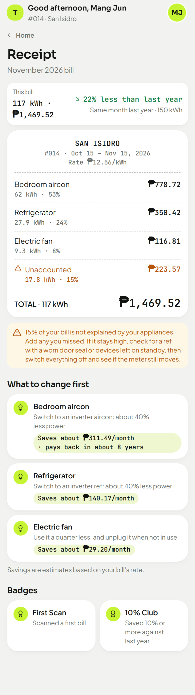
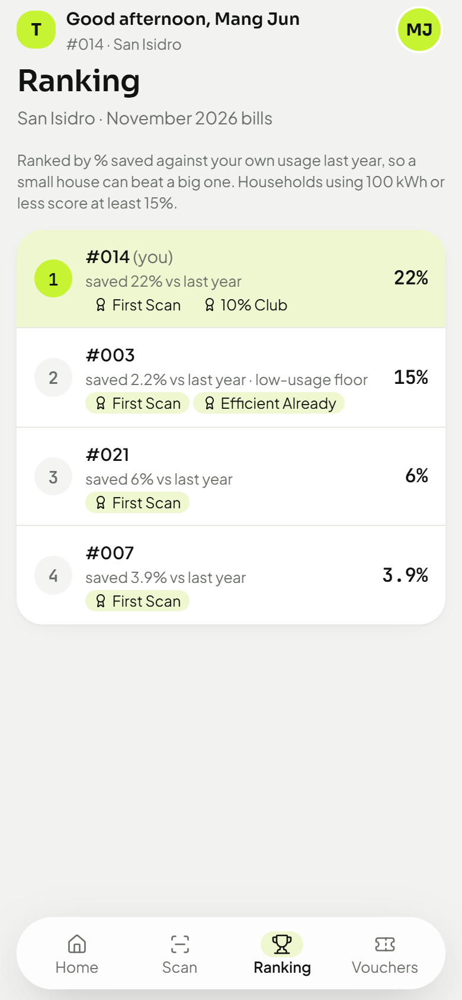
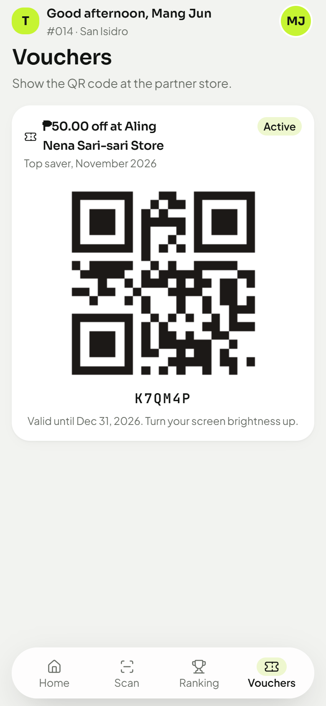

# Kuryentipid

> Your barangay's fair energy-saving challenge. Scan your Meralco bill and your appliance stickers to see what each appliance really costs you, then compete with your neighbors on **% saved**, not raw kWh, for badges and sari-sari store vouchers.

**Status:** MVP built and passing unit + end-to-end tests. Remaining: deploy, test with real Meralco bills, and rehearse the demo ([TASKS.md](TASKS.md)). Assign owners in §2 first.

---

## Pre-Flight Checklist

No coding begins until all of these are done. AI agents must refuse feature work while any box is unchecked (see [AGENTS.md](AGENTS.md)).

- [x] Problem and target users are clear (§1)
- [x] MVP features are defined, out-of-scope list written (§1)
- [x] Tech stack is selected (§3)
- [x] Design system is documented ([DESIGN_SYSTEM.md](DESIGN_SYSTEM.md))
- [x] Anti-slop rules are established ([DESIGN_SYSTEM.md](DESIGN_SYSTEM.md#anti-slop-rules))
- [x] Required skills and integrations are identified (§2)
- [x] Architecture is planned ([ARCHITECTURE.md](ARCHITECTURE.md))
- [x] Project structure is agreed upon ([ARCHITECTURE.md](ARCHITECTURE.md#folder-structure))
- [x] AI agent instructions are ready ([AGENTS.md](AGENTS.md))
- [x] Initial task breakdown is complete ([TASKS.md](TASKS.md))

---

## 1. Project overview

| | |
|---|---|
| **Problem** | An electric bill is one number. Households can't cut what they can't see, so they switch off lights (which barely matter) while an old ref or non-inverter aircon eats most of the bill. And even people who do save have no reason to keep at it: no feedback, no recognition, no reward. Community saving drives that rank by raw kWh are unfair, because a big house can "save" more kWh by accident than a small house can use in a month. |
| **Target users** | **Residents** of a barangay who pay their own Meralco bill (main user). **Barangay officials** who run the challenge and review flagged bills. **Sari-sari store owners** who redeem vouchers. |
| **Value proposition** | No smart meter, no hardware. A phone camera turns the bill into a line-by-line receipt showing *what* to fix, and a fair barangay ranking gives people a reason to come back and keep saving every month. |
| **Hackathon theme** | **SDG 7: Affordable and Clean Energy.** Target 7.1 (affordable access) and 7.3 (energy efficiency). Also touches SDG 11 (sustainable communities). |
| **Judging criteria** | Technical quality, functionality, innovation, originality, presentation/demo — 20% each. |

### The twists

1. **Fair scoring.** You compete against your own past usage, not your neighbors' kWh. A small house can beat a mansion.
2. **The receipt has to add up.** Per-appliance estimates are calibrated so they sum to the kWh on the real bill. Usage your appliances can't explain shows up as an **"Unaccounted" line**: a forgotten appliance, a failing ref seal, a leak, or a meter worth questioning.

### Fair score rules

| Rule | Why |
|---|---|
| **Baseline = same month last year**, read from the 12-month usage history printed on the bill. If that's missing, use the average of the last 3 months on the bill. | Removes the summer (April–May) penalty, and you can't inflate a past month to game it. |
| **Savings % = (baseline − current) ÷ baseline**, capped at 30%. | Stops an empty house during a vacation from winning. |
| **Low-usage floor:** households at ≤ 100 kWh/month score at least 15% and get the "Efficient Already" badge. | Households already using very little have nothing left to cut, so a pure % rule would punish the poorest. |
| **One account number = one household.** | Prevents entering the same bill twice. |
| **Plausibility check:** amount ÷ kWh must fall in a believable ₱/kWh range; account number must match the household's previous bills. Failures go to barangay review instead of the leaderboard. | Catches someone uploading a neighbor's bill or an edited photo. |

### How it scores (20% each)

| Criterion | How the demo proves it |
|---|---|
| Technical quality | Vision extraction from two kinds of document (bill, appliance sticker); reconciliation against the bill total; fair-score rules with anti-cheat checks. |
| Functionality | The full loop works live: scan → receipt → leaderboard → voucher redeemed at a store. No mocked screens. |
| Innovation | Fair % scoring tied to the bill's own history, and the "Unaccounted" line. |
| Originality | A barangay + sari-sari reward loop: local, social, and built around how Filipino communities actually work. |
| Presentation and demo | "Mang Jun's small house beat the mansion across the street. He saved 22%, got a ₱50 voucher at Aling Nena's store, and the app told him exactly which appliance to fix." |

### MVP (must work at demo time)

1. **Scan the bill:** AI extracts account number, billing period, kWh, amount due, and the 12-month usage history. Every field is editable before confirming. Effective rate = amount ÷ kWh (Meralco bills include generation, transmission and other charges, so kWh × a single rate is wrong).
2. **Scan appliances:** photograph each appliance's nameplate sticker; AI extracts type and wattage. If unreadable, pick from a list with typical wattage. Usage hours pre-filled and editable.
3. **Itemized receipt:** per-appliance kWh and ₱, reconciled to the bill, sorted by cost, with an "Unaccounted" line for every material gap (prominent when the gap is large). The top 3 lines each show one concrete swap with monthly saving and payback months.
4. **Barangay leaderboard:** monthly ranking by fair score (rules above); your row stays visible while you scroll.
5. **Badges:** First Scan, 10% Club (actual savings), Efficient Already, Top 3 in Barangay (from the leaderboard).
6. **Vouchers:** monthly top savers receive a single-use QR voucher. The store owner's page scans the QR on browsers with camera QR support, or enters the 6-character code; a used code can't be redeemed again.
7. **Barangay admin page:** review flagged bills (approve/reject), set the monthly voucher count and amount, approve store sign-ups and see what each store has redeemed.
8. **Sign-up by role:** pick Household, Sari-sari store (waits for admin approval before it can receive vouchers) or Barangay admin (needs the admin access code). Privacy consent (RA 10173) is required to create any account.
9. **AI fallback providers (admin):** the admin page lists the photo-reading chain in order and lets the admin add more providers (OpenAI, Claude, Gemini, Grok, Groq, OpenRouter or any OpenAI-compatible API). Each one must pass a test on a sample bill, with a step-by-step log, before it can be added. Keys are stored encrypted.

### Out of scope

- Meter camera / real-time monitoring (roadmap: phone camera on the meter for daily feedback, "Meter-Verified" badge, water leak alerts).
- Payments or actual money transfer; the voucher is honored by the partner store.
- Multiple barangays or cross-barangay rankings.
- Bill formats other than Meralco.
- SMS/push notifications.
- Native mobile app (responsive web app; the phone camera works through the browser).

## 2. Required skills

All rows apply. Fill in an owner for each; one person can own several.

| Skill | What it means here | Owner |
|---|---|---|
| UI/UX design | Scan → receipt → ranking flow; receipt layout; DESIGN_SYSTEM.md | |
| Frontend | Next.js screens, PhotoCapture, receipt, leaderboard, voucher QR | |
| Backend | Server Actions, extraction routes, scoring logic | |
| Database | Supabase schema, constraints, RLS policies, leaderboard view | |
| AI integration | Claude vision extraction with Zod schemas; testing on real Meralco bills and stickers | |
| Authentication | Supabase email + password login (accounts created server-side, already confirmed) or Google sign-in (Google Identity Services button; the server verifies Google's ID token and starts the Supabase session), three roles picked at sign-up. A failed sign-in says whether the email isn't registered, uses Google, or has the wrong password | |
| Git/GitHub | Branching and merges per CONTRIBUTING.md | |
| Testing | Scoring unit checks; TESTING.md run-through | |
| Deployment | Vercel + Supabase project, env vars | |
| Accessibility | Contrast, focus, labels, 44px targets | |
| Pitch/demo | Demo script, real bill + stickers, backup recording | |

## 3. Technology stack

No dependency gets added beyond this list without a written reason.

| Layer | Choice | Why |
|---|---|---|
| Frontend + backend | **Next.js** (App Router, TypeScript strict) | Screens and server code in one project and one deploy; server code keeps the AI key secret |
| Database | **Supabase Postgres** | Real SQL with constraints (unique account number, single-use voucher); role checks in server code, with RLS as defense in depth |
| Auth | **Supabase Auth** (email + password) | Comes with the database. Accounts are created server-side as confirmed, because Supabase's built-in mailer allows only a few emails per hour, which would break a live demo |
| File storage | **Supabase Storage** (private bucket) | Bill photos stay private to the owner and their barangay admin |
| AI | **Gemini** via `@google/genai` (free tier) in a fallback chain: Flash → Flash-Lite → optional **Claude Haiku 5.5** (`@anthropic-ai/sdk`) → manual entry. Structured JSON validated with Zod | Free for the hackathon; if one model hits its quota or fails, the next catches it, and manual entry means scanning never dead-ends |
| Validation | **Zod** | One schema validates both AI output and user input |
| Styling | **Tailwind CSS** with tokens from `src/app/globals.css` (light + dark) | Fast to build; tokens enforce the design system |
| UI components | Own small primitives in `components/ui.tsx`, `components/field.tsx` and `components/form.tsx` (Button, Field, Notice, Card, IconTile, Skeleton, ValidatedForm, ConfirmDialog) | Only a handful were needed; shadcn was allowed but not required |
| Toasts | **sonner** | Accessible, dismissible success/error toasts without a custom live-region implementation |
| Landing page interaction | CSS height transitions (fair-score slider); a sticky month strip that follows the section you read (IntersectionObserver, no library) | The homepage walks one billing month; Three.js and GSAP were removed with the old hero (2026-11-23) |
| Icons | **lucide-react** | One consistent SVG set |
| QR | **qrcode** (generate); the store page uses the browser's native `BarcodeDetector` where available, with the typed 6-character code everywhere | No extra scanner dependency; the typed code always works |
| Deployment | **Vercel** + Supabase cloud (free tiers) | Zero-config Next.js hosting |
| External APIs | Google Gemini API; Anthropic API (optional fallback) | |

## Screenshots

| Home (light) | Home (dark) | Avatar menu |
|---|---|---|
|  |  |  |

| Receipt | Ranking | Vouchers |
|---|---|---|
|  |  |  |

| Store redeem | Admin review | Profile |
|---|---|---|
|  |  |  |


Screens show a temporary "San Isidro" example barangay with representative demo data.

## 4. Getting started

```bash
git clone <repo> && cd kuryentipid
cp .env.example .env.local      # fill in values (see comments in the file)
npm install
npm run db:migrate              # apply supabase/migrations (needs SUPABASE_DB_URL)
npm run seed:demo               # optional: demo barangay (set DEMO_PASSWORD first)
npm run dev                     # http://localhost:3000
npm test                        # scoring unit tests
npm run e2e                     # full demo loop in Microsoft Edge (dev server must be running)
```

**Roles at sign-up** (`/login?mode=up`): Household, Sari-sari store, or Barangay admin.
- **Admins** enter the admin access code (`ADMIN_SIGNUP_CODE`, 12+ characters; share it only with officials). Emails in `ADMIN_EMAILS` always become admins.
- **Store owners** sign up with their store's name; the store waits on the admin page until the admin approves it. The admin can also link an existing account as a store by email.

**Google sign-in:** set `NEXT_PUBLIC_GOOGLE_CLIENT_ID`. In Google Cloud → APIs & Services → Credentials → your OAuth client → **Authorized JavaScript origins**, add `http://localhost`, `http://localhost:3000` and your deployed URL. No redirect URI and no client secret are needed, and nothing has to be enabled in Supabase. If the OAuth consent screen is in *Testing*, only listed test users can sign in. Keep the downloaded `client_secret_*.json` out of git (it's ignored).

**Demo accounts** (after `npm run seed:demo`): `resident@`, `neighbor@`, `admin@`, `store@tipidtayo.test` plus 5 more households, all with `DEMO_PASSWORD`. See [DEMO.md](DEMO.md) for the 2-minute demo script.

## 5. Execution workflow

1. **Research**: problem, users, judging criteria.
2. **Define the MVP**: what must work. Nothing else.
3. **Design system**: tokens, type, components ([DESIGN_SYSTEM.md](DESIGN_SYSTEM.md)).
4. **Architecture**: stack, data model, structure ([ARCHITECTURE.md](ARCHITECTURE.md)).
5. **Build the core journey first.**
6. **Integrate and test** ([TESTING.md](TESTING.md)).
7. **Polish and submit**: UI quality, mobile, demo run-through, docs accurate.

## 6. Security and reliability

- Validate all user input at the server; sanitize anything rendered from untrusted sources.
- Secrets live in `.env` only, never in code or commits. `.env` is gitignored.
- Every API endpoint checks authentication and authorization.
- External API calls handle timeouts and failures with a visible error state.
- Review new dependencies before adding (maintenance, size, known vulnerabilities).

## Project docs

| File | Purpose |
|---|---|
| [DESIGN_SYSTEM.md](DESIGN_SYSTEM.md) | Design tokens, components, anti-slop rules, UX states |
| [ARCHITECTURE.md](ARCHITECTURE.md) | Architecture, schema, API conventions, folder structure, coding standards |
| [AGENTS.md](AGENTS.md) | Rules for AI coding agents |
| [CONTRIBUTING.md](CONTRIBUTING.md) | Git and collaboration rules |
| [TASKS.md](TASKS.md) | Hackathon task breakdown |
| [TESTING.md](TESTING.md) | QA checklist |
| [.env.example](.env.example) | Required environment variables |
